# Technical Architecture — Zorin Copilot

[🇺🇸 English Version](ARCHITECTURE.en.md) | [🇧🇷 Versão em Português](ARCHITECTURE.md)

**Zorin Copilot** is a native, high-fidelity AI assistant built specifically for Linux desktop environments, featuring validated support for **GNOME 46+ (Wayland/X11)**, **KDE Plasma 6**, **Hyprland**, and **wlroots-based compositors (Sway)**.

Unlike architectures relying solely on continuous pixel streaming or full-screen OCR, Zorin Copilot prioritizes semantic interface introspection using native operating system buses (**AT-SPI2**, **D-Bus**, and Wayland protocols), invoking multimodal vision (VLM) models strictly on-demand for specific Regions of Interest (ROI).

---

## 1. Architectural Layers Overview

The codebase is organized into five decoupled layers with strict contracts:

```
┌────────────────────────────────────────────────────────────────────────┐
│                        Layer 5: User Interfaces                        │
│   • GTK4 / Libadwaita (Spotlight HUD)  • Layer-Shell (OSD Voice Pill)  │
│   • CLI (zorin-copilot-cli)            • HY4 Terminal (hy4 CLI)        │
└───────────────────────────────────┬────────────────────────────────────┘
                                    │
                                    ▼
┌────────────────────────────────────────────────────────────────────────┐
│                 Layer 4: Intelligence & Orchestration                  │
│   • AgentLoop (State Machine)          • Fast RNN Router               │
│   • Subagents (Window Analyst, Code)   • Shared Scratchpad             │
│   • Multi-Agent Cluster (CrewAI/Seq)   • Providers (Local / Cloud)     │
└──────────────────┬─────────────────────────────────┬───────────────────┘
                   │                                 │
                   ▼                                 ▼
┌──────────────────────────────────────┐  ┌──────────────────────────────┐
│          Layer 3: Perception         │  │   Layer 2: Shell & Safety    │
│ • AT-SPI2 (A11y Tree Traversal)      │  │ • RiskPolicy (Safe/Confirm)  │
│ • Desktop Context (D-Bus / Sway IPC) │  │ • ScreenFenceManager (Zones) │
│ • VLM Grounding & Continuous Vision  │  │ • UndoStack (Reversibility)  │
│ • Local Audio (Whisper INT8 + Piper) │  │ • Input Drivers (libei/ydot) │
└──────────────────┬───────────────────┘  └──────────────┬───────────────┘
                   │                                     │
                   └──────────────────┬──────────────────┘
                                      │
                                      ▼
┌────────────────────────────────────────────────────────────────────────┐
│                         Layer 1: Integrations                          │
│ • Google Workspace (Calendar, Drive, Gmail via OAuth2 Desktop app)     │
│ • Home Assistant (Realtime WebSocket & TTS announcements)              │
│ • Model Context Protocol (MCP SSE/Stdio Client)                        │
│ • n8n Webhook Automations & Local RAG / SQLite Memory                  │
└────────────────────────────────────────────────────────────────────────┘
```

---

## 2. Module Specifications

### Layer 3: Desktop Perception & Monitoring (`zorin_copilot.core`)

Perception combines structured semantic extraction with selective computer vision:

1. **Semantic Inspection via AT-SPI2 (`core/a11y.py`):**
   - Directly interfaces with the accessibility bus (`org.a11y.Bus`).
   - Maps UI components at runtime without display capture latency: widget roles (`button`, `entry`, `menu_item`, `page_tab`), accessibility labels, focus states, and absolute coordinates within the active screen geometry.
   - Enables fuzzy searching of UI nodes by text label, role, or functional path.

2. **Desktop Environment Abstraction (`core/desktop/`):**
   - Dynamically identifies the host distribution (Zorin OS, Ubuntu, Arch Linux, Fedora) and running compositor (GNOME/Mutter, KDE/KWin, Hyprland, Sway).
   - `core/desktop/shortcuts.py`: Binds global hotkeys through the appropriate system backend (`gsettings/media-keys` on GNOME, `kglobalshortcutsrc` on KDE, configuration file snippets on Hyprland/Sway).
   - `core/desktop/screenshot.py`: Coordinates display capture via the XDG Desktop Portal (`org.freedesktop.portal.Screenshot`), `grim` (Wayland/wlroots), or `spectacle` (KDE).

3. **Multimodal Vision and Visual Grounding (`core/vision.py`, `core/vlm_grounding.py`):**
   - For applications lacking an accessible AT-SPI2 tree (such as custom OpenGL/Vulkan canvas surfaces or WebGL views), the VLM subsystem captures cropped screenshots of target regions and produces normalized bounding boxes to compute target click coordinates.

4. **Local Audio and Neural Voice (`core/audio/`, `ai/local_voice.py`, `core/dictation.py`):**
   - Offline transcription powered by `faster-whisper` using INT8 quantization executed on CPU.
   - Voice Activity Detection (VAD) for fast silence suppression and low-latency chunk streaming.
   - Local speech synthesis using `piper-tts` (Portuguese neural voice model `pt_BR-faber-medium`).
   - Lightweight offline wake word engine utilizing `vosk`.

---

### Layer 4: Intelligence, Agent Execution, and Routing (`zorin_copilot.ai`)

This layer is decoupled from graphical libraries and fully testable in headless environments:

1. **Agent State Machine (`ai/agent.py` — `AgentLoop`):**
   - Executes a deterministic cycle: **Perception → Reasoning → Risk Verification → Execution → Observation**.
   - Supports milestone tracking and autonomous replanning when intermediate actions fail.
   - Prevents execution runaways via hard step limits (`max_steps`), global execution deadlines (`max_seconds`), and consecutive failure detection (`repeated_failure`).

2. **Specialized Subagents and Scratchpad (`ai/subagents.py`):**
   - `window_analyst`: Focused subagent evaluating active or secondary windows in isolation to conserve main context window tokens.
   - `research`: Handles web navigation and local RAG retrieval without cluttering the primary agent prompt.
   - `code`: Inspects and debugs scripts within the user's workspace.
   - **Shared Scratchpad:** Structured working memory shared between the coordinator and subagents to store intermediate discoveries.

3. **Model Routing (`ai/agent_router.py`, `ai/fast_rnn_router.py`):**
   - Assesses instruction intent complexity:
     - Straightforward commands and deterministic desktop operations route to the local model (Ollama / Qwen2.5 / Dolphin 3.1).
     - Multi-turn planning, complex cross-application tasks, or advanced visual grounding escalate to cloud providers (Gemini / Claude / WorkBuddy HY4).

---

### Layer 2: Shell Execution, Safety Sandbox, and Reversibility (`zorin_copilot.shell`)

Interacting with a live desktop requires strict guardrails against accidental data loss or desktop instability:

```
[Proposed Model Action]
           │
           ▼
[Filter 1: ScreenFenceManager] ──(Coordinate outside boundary?)──► REJECTED
           │ (Inside boundary)
           ▼
[Filter 2: RiskPolicy] ─────────(Destructive action / CONFIRM?)──► Request User Approval
           │ (SAFE or User Approved)
           ▼
[Filter 3: UndoStack] ──────────(Modifies filesystem?)───────────► Record Snapshot
           │
           ▼
[InputDriver / ActionExecutor]
  ├── AT-SPI doAction (Semantic direct dispatch without cursor movement)
  ├── libei / ydotool (Virtual input injection under Wayland)
  └── Sandboxed subprocesses
```

1. **Risk Policy Engine (`shell/risk.py`):**
   - Evaluates every tool invocation against strict classification rules: `SAFE` or `CONFIRM`.
   - File writes, process terminations, shell executions, and destructive hotkeys (`Alt+F4`, `Ctrl+Q`) require interactive user confirmation.

2. **Digital Screen Fence (`core/fence.py`):**
   - Enforces geometric bounds, blocking simulated clicks or inspections targeting restricted display areas or secondary monitors holding sensitive data.

3. **Undo Stack (`shell/undo.py`):**
   - Takes pre-execution snapshots of text files and directory structures before mutations occur.
   - Restores modified assets via the global `Ctrl+Z` shortcut or command palette.

---

### Layer 5: User Interfaces (`zorin_copilot.ui`)

1. **Main Window (Spotlight / Raycast Style):**
   - Implemented in **GTK4** and **Libadwaita** with a dedicated glassmorphism stylesheet (`data/zorin-copilot.css`).
   - Modular widget hierarchy:
     - `PromptBar`: Text input area with expandable popovers for continuous vision, clipboard status, and drag-and-drop file attachments.
     - `ChatStream`: Streaming turn renderer with step-by-step agent progress steppers and inline action execution cards.
     - `Blackboard`: Mathematical chalkboard with real-time KaTeX/LaTeX formatting.
     - `Sidebar`: Conversation history stored locally in SQLite (`memory.db`).

2. **OSD Dictation and Voice Pill (`ui/dictation_osd.py`, `ui/voice_pill.py`):**
   - Lightweight floating window maintaining target window focus without interruption.
   - Visualizes live audio waveforms, VAD activity, and real-time transcription status.

3. **Command Line Utilities (`zorin-copilot-cli` and `hy4`):**
   - Provide scriptable interfaces for terminal workflows:
     - `zorin-copilot-cli doctor`: Validates AT-SPI2, Wayland, and D-Bus subsystems.
     - `zorin-copilot-cli agent "objective"`: Executes autonomous desktop loops with `--dry-run` and `--local-only` support.
     - `hy4`: Terminal interface for the Tencent HY4 model via WorkBuddy AI featuring configurable thinking stream display.

---

## 3. End-to-End Execution Sequence

The sequence diagram below details the execution flow for a multi-step desktop task:

```mermaid
sequenceDiagram
    autonumber
    actor User as User
    participant UI as Interface / CLI
    participant Agent as AgentLoop
    participant Router as AgentRouter
    participant Reg as ToolRegistry
    participant Safety as RiskPolicy / Fence
    participant Shell as Executor (AT-SPI / libei)

    User->>UI: "Find invoice in email and save to Documents"
    UI->>Agent: run(objective)
    Agent->>Router: Classify intent and select model
    Router-->>Agent: Selected Provider

    loop Step Execution Loop (until finish or timeout)
        Agent->>Reg: Inspect screen state
        Reg->>Shell: Query AT-SPI2 tree / Active windows
        Shell-->>Reg: Structured UI context
        Reg-->>Agent: State observation

        Agent->>Agent: Plan next step and format tool call
        Agent->>Safety: Validate tool name and parameters
        alt Action requires approval (CONFIRM)
            Safety->>UI: Request user confirmation
            User-->>UI: Approve
            UI-->>Safety: Confirmed
        end
        Safety->>Shell: Dispatch action (click / write / hotkey)
        Shell-->>Agent: Execution outcome (ok / error)
    end

    Agent-->>UI: AgentResult (Task completed)
    UI-->>User: Visual completion status
```



