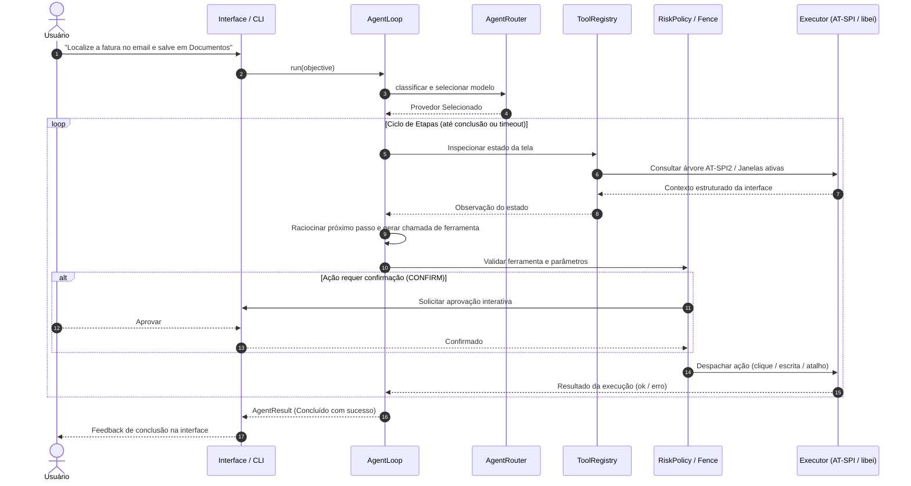

# Arquitetura Técnica — Zorin Copilot

[🇺🇸 English Version](ARCHITECTURE.en.md) | [🇧🇷 Versão em Português](ARCHITECTURE.md)

O **Zorin Copilot** é um assistente de inteligência artificial de alta fidelidade desenvolvido para operar nativamente no ambiente desktop Linux, com suporte a **GNOME 46+ (Wayland/X11)**, **KDE Plasma 6**, **Hyprland** e compositores baseados em **wlroots (Sway)**.

Ao contrário de abordagens baseadas exclusivamente em scraping visual ou OCR de tela inteira, o Zorin Copilot prioriza a extração semântica da hierarquia de interface por meio de barramentos do sistema operacional (**AT-SPI2**, **D-Bus** e protocolos Wayland), acionando modelos de visão multimodal (VLM) apenas sob demanda para regiões de interesse (*Region of Interest* — ROI).

---

## 1. Visão Geral das Camadas

O sistema é estruturado em cinco camadas com contratos bem definidos e baixo acoplamento:

```
┌────────────────────────────────────────────────────────────────────────┐
│                   Camada 5: Interfaces do Usuário                      │
│   • GTK4 / Libadwaita (Spotlight HUD)  • Layer-Shell (Pílula OSD)      │
│   • CLI (zorin-copilot-cli)            • Terminal HY4 (hy4 CLI)        │
└───────────────────────────────────┬────────────────────────────────────┘
                                    │
                                    ▼
┌────────────────────────────────────────────────────────────────────────┐
│               Camada 4: Inteligência & Orquestração                    │
│   • AgentLoop (Máquina de estados)     • Fast RNN Router               │
│   • Subagents (Window Analyst, Code)   • Shared Scratchpad             │
│   • Multi-Agent Cluster (CrewAI/Seq)   • Provedores (Local / Nuvem)    │
└──────────────────┬─────────────────────────────────┬───────────────────┘
                   │                                 │
                   ▼                                 ▼
┌──────────────────────────────────────┐  ┌──────────────────────────────┐
│        Camada 3: Percepção           │  │   Camada 2: Shell & Safety   │
│ • AT-SPI2 (Árvore de A11y)           │  │ • RiskPolicy (Safe/Confirm)  │
│ • Desktop Context (D-Bus / Sway IPC) │  │ • ScreenFenceManager (Zonas) │
│ • VLM Grounding & Continuous Vision  │  │ • UndoStack (Reversibilidade)│
│ • Áudio Local (Whisper INT8 + Piper) │  │ • Input Drivers (libei/ydot) │
└──────────────────┬───────────────────┘  └──────────────┬───────────────┘
                   │                                     │
                   └──────────────────┬──────────────────┘
                                      │
                                      ▼
┌────────────────────────────────────────────────────────────────────────┐
│                      Camada 1: Integrações                             │
│ • Google Workspace (Calendar, Drive, Gmail via OAuth2 Desktop app)     │
│ • Home Assistant (WebSocket tempo real & TTS announce)                 │
│ • Model Context Protocol (Cliente MCP SSE/Stdio)                       │
│ • Automações n8n & Local RAG / SQLite Memory                           │
└────────────────────────────────────────────────────────────────────────┘
```

---

## 2. Detalhamento dos Módulos

### Camada 3: Percepção e Monitoramento do Desktop (`zorin_copilot.core`)

A percepção combina introspecção semântica estruturada e visão computacional sob demanda:

1. **Inspeção Semântica via AT-SPI2 (`core/a11y.py`):**
   - Conecta-se diretamente ao barramento de acessibilidade (`org.a11y.Bus`).
   - Mapeia elementos em tempo de execução sem latência de captura de tela: papéis de widgets (`button`, `entry`, `menu_item`, `page_tab`), nomes acessíveis, estados de foco e coordenadas absolutas no sistema de coordenadas da tela.
   - Permite a busca difusa de elementos por texto, classe ou função.

2. **Abstração de Ambientes Gráficos (`core/desktop/`):**
   - Detecta dinamicamente a distribuição (Zorin OS, Ubuntu, Arch, Fedora) e o compositor ativo (GNOME/Mutter, KDE/KWin, Hyprland, Sway).
   - `core/desktop/shortcuts.py`: Registra atalhos globais de sistema usando o backend correto (`gsettings/media-keys` no GNOME, `kglobalshortcutsrc` no KDE, snippets de configuração no Hyprland/Sway).
   - `core/desktop/screenshot.py`: Gerencia captura de tela via XDG Desktop Portal (`org.freedesktop.portal.Screenshot`), `grim` (Wayland/wlroots) ou `spectacle` (KDE).

3. **Visão Multimodal e Grounding (`core/vision.py`, `core/vlm_grounding.py`):**
   - Quando um elemento não possui representação acessível na árvore AT-SPI2 (por exemplo, em aplicações de renderização customizada como jogos ou canvas WebGL), o subsistema VLM captura uma imagem da área alvo e projeta caixas delimitadoras (*bounding boxes*) normalizadas para conversão em coordenadas de clique.

4. **Subsistema de Áudio e Voz Local (`core/audio/`, `ai/local_voice.py`, `core/dictation.py`):**
   - Transcrição offline via `faster-whisper` com quantização INT8 rodando em CPU.
   - Detecção de atividade de voz (VAD) para supressão de silêncio e latência reduzida.
   - Síntese de fala local neural via `piper-tts` (modelo em português brasileiro `pt_BR-faber-medium`).
   - Reconhecimento de palavra de ativação (*wake word*) offline com `vosk`.

---

### Camada 4: Inteligência, Agente e Roteamento (`zorin_copilot.ai`)

Esta camada é agnóstica de interface gráfica e pode ser executada integralmente em modo headless:

1. **Máquina de Estados do Agente (`ai/agent.py` — `AgentLoop`):**
   - Implementa o ciclo determinístico: **Percepção → Raciocínio → Validação de Risco → Execução → Observação**.
   - Suporta *milestone tracking* (marcos de progresso) e replanejamento autônomo quando uma etapa falha.
   - Proteções contra loops infinitos: limite de passos (`max_steps`), tempo limite global (`max_seconds`) e detecção de falha repetida consecutiva (`repeated_failure`).

2. **Subagentes Especializados e Scratchpad (`ai/subagents.py`):**
   - `window_analyst`: Subagente focado em analisar a janela em primeiro plano ou janelas secundárias em paralelo, isolando o contexto.
   - `research`: Navegação web e consulta a documentos RAG sem poluir o contexto da conversa principal.
   - `code`: Análise e depuração de scripts no ambiente do usuário.
   - **Shared Scratchpad:** Bloco de notas estruturado compartilhado entre o agente coordenador e os subagentes para preservar descobertas intermediárias.

3. **Roteamento de Modelos (`ai/agent_router.py`, `ai/fast_rnn_router.py`):**
   - Classifica a complexidade da intenção do usuário:
     - Consultas triviais e ações de desktop determinísticas são roteadas para o modelo local (Ollama / Qwen2.5 / Dolphin 3.1).
     - Raciocínios elaborados, tarefas multi-etapas complexas ou visão multimodal avançada escalam para provedores em nuvem (Gemini / Claude / WorkBuddy HY4).

---

### Camada 2: Execução de Shell, Segurança e Reversibilidade (`zorin_copilot.shell`)

Executar ações em um desktop real exige proteções estritas contra danos colaterais:

```
[Proposta de Ação da IA]
           │
           ▼
[Filtro 1: ScreenFenceManager] ──(Coordenada fora da cerca?)──► REJEITADA
           │ (Dentro da cerca)
           ▼
[Filtro 2: RiskPolicy] ─────────(Ação destrutiva / CONFIRM?)──► Solicita Aprovação
           │ (SAFE ou Aprovado pelo Usuário)
           ▼
[Filtro 3: UndoStack] ──────────(Modifica arquivos?)──────────► Grava Snapshot
           │
           ▼
[InputDriver / Executor]
  ├── AT-SPI doAction (Semântico direto, sem mover cursor)
  ├── libei / ydotool (Injeção virtual no Wayland)
  └── Subprocessos isolados
```

1. **Política de Risco (`shell/risk.py`):**
   - Classifica toda chamada de ferramenta em `SAFE` ou `CONFIRM`.
   - Modificações de arquivo, encerramento de processos, execução de comandos shell e atalhos globais de encerramento (`Alt+F4`, `Ctrl+Q`) exigem confirmação explícita do usuário.

2. **Cerca Digital de Tela (`core/fence.py`):**
   - Impede que cliques simulados ou inspeções visuais saiam da área de monitor definida pelo usuário, protegendo janelas sensíveis ou monitores secundários com dados confidenciais.

3. **Pilha de Desfazer (`shell/undo.py`):**
   - Armazena snapshots anteriores a modificações em arquivos texto ou reorganizações de pastas.
   - Permite desfazer as últimas 5 ações através do atalho global `Ctrl+Z` ou via comando.

---

### Camada 5: Interfaces de Usuário (`zorin_copilot.ui`)

1. **Janela Principal (Spotlight / Raycast Style):**
   - Desenvolvida em **GTK4** e **Libadwaita** com folha de estilo customizada glassmorphism (`data/zorin-copilot.css`).
   - Composta por widgets modulares desacoplados:
     - `PromptBar`: Entrada de texto com popovers de visão contínua, status do clipboard e anexo de arquivos.
     - `ChatStream`: Exibição de mensagens em streaming, stepper de etapas do agente e cards de ações executáveis.
     - `Blackboard`: Quadro de anotações e resolução matemática passo a passo com renderização KaTeX/LaTeX.
     - `Sidebar`: Histórico de conversas indexado localmente em SQLite.

2. **Pílula OSD de Ditado e Voz ao Vivo (`ui/dictation_osd.py`, `ui/voice_pill.py`):**
   - Janela flutuante não-intrusiva que preserva o foco do aplicativo ativo.
   - Exibe animação de volume em tempo real, status do VAD e prévia da transcrição.

3. **Linha de Comando (`zorin-copilot-cli` e `hy4`):**
   - Permite automação, scripting e execução de tarefas sem interface gráfica:
     - `zorin-copilot-cli doctor`: Diagnóstico completo de permissões e barramentos do sistema.
     - `zorin-copilot-cli agent "objetivo"`: Execução do loop autônomo com suporte a `--dry-run` e `--local-only`.
     - `hy4`: Cliente de terminal oficial para o modelo Tencent HY4 via WorkBuddy AI com exibição configurável da cadeia de raciocínio (*thinking*).

---

## 3. Fluxo de Execução de Tarefa do Agente

O diagrama abaixo ilustra o ciclo de vida completo de uma instrução complexa:


